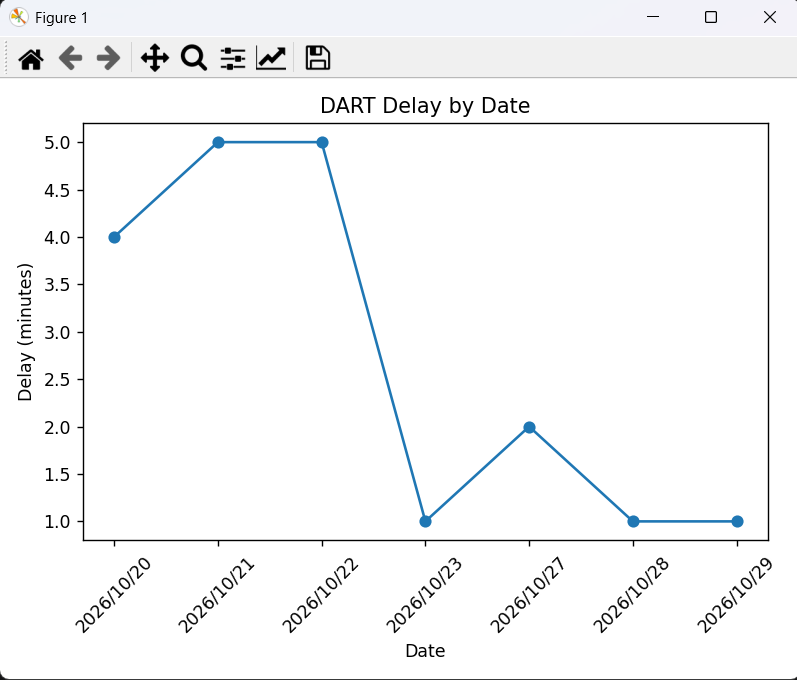
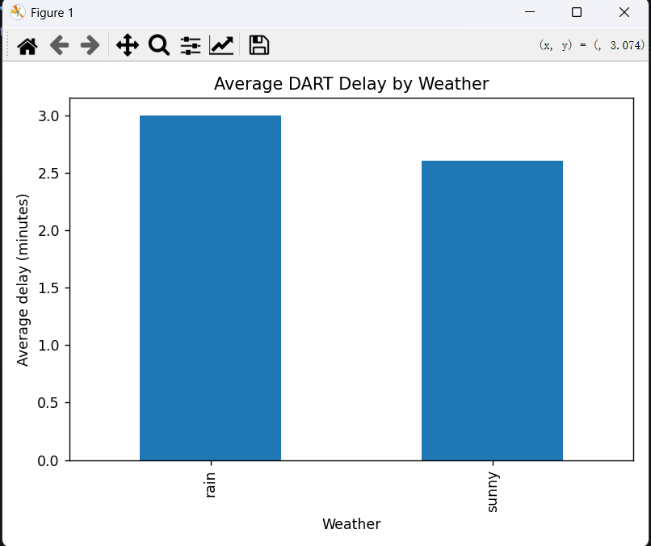
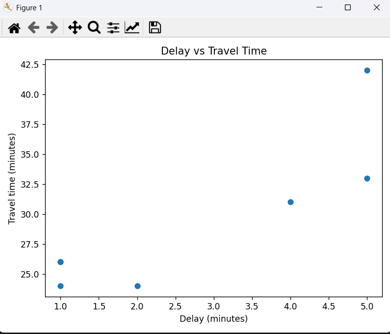

# DART Commute Analysis

## Assignment Proposal

### Project Description

This project records and analyses my personal DART commute data.

The dataset is collected manually during my journeys. Each row represents one commute and records information such as the scheduled departure time, actual departure time, delay, weather, seat availability, total travel time and arrival time.

The aim of the project is to investigate patterns in my DART journeys and find out which factors may be related to delays and travel time.

---

## Research Questions

The project will investigate the following questions:

1. Is the DART usually more delayed during rainy weather?
2. How does the departure delay affect my total travel time?
3. Are there patterns in journey time and seat availability across different journeys?

---

## Data Dictionary

| Column | Type | Unit / Values | Description |
|---|---|---|---|
| date | Date | YYYY-MM-DD | Date of the journey |
| scheduled_time | Time | HH:MM | Scheduled DART departure time |
| actual_time | Time | HH:MM | Actual DART departure time |
| delay_minutes | Integer | minutes | Difference between scheduled and actual departure time |
| weather | Categorical | rain / cloudy / sunny / etc. | Weather observed during the journey |
| got_seat | Categorical | yes / no | Whether I was able to get a seat |
| travel_time | Integer | minutes | Total journey time |
| arrival_time | Time | HH:MM | Actual arrival time |

---

## Data Collection Method

The data is collected manually during my DART journeys.

For each journey I record the information on the same day rather than estimating it later.

The scheduled departure time is taken from the DART timetable information available at the time of travel.

The actual departure time and arrival time are recorded during the journey.

The delay in minutes is calculated as the difference between the scheduled departure time and the actual departure time.

Weather is recorded based on the conditions I observe during the journey.

Seat availability is recorded as either `yes` or `no`.

The dataset is stored in:

`data/commute.csv`

The CSV file will continue to be updated as new journeys are recorded.

---

## Current Progress

The following parts of the project have currently been implemented:

- A manually collected CSV dataset has been created.
- Python reads the commute data from the CSV file.
- Numeric values such as delay and travel time are converted to integer values.
- The data is inserted into an SQLite database.
- SQL queries are used to calculate values such as average delay and average delay by weather.
- The SQLite database is loaded into a pandas DataFrame.
- pandas is used to calculate summary statistics.
- matplotlib is used to create data visualisations.
- A terminal menu has been created so that the user can select different charts.

Data collection and development will continue after the proposal submission.

---

## Current Visualisations

### DART Delay by Date

This line chart shows how the departure delay changes between recorded journeys.



### Average DART Delay by Weather

This bar chart compares the average delay under different weather conditions.



### Delay vs Travel Time

This scatter plot is used to investigate whether a larger departure delay is associated with a longer total travel time.



---

## How the Current Program Works

The program currently follows these main steps:

1. Read the manually collected data from `commute.csv`.
2. Convert numeric fields into integer values.
3. Create and connect to an SQLite database.
4. Insert the CSV data into the database.
5. Run SQL queries on the commute data.
6. Load the database table into pandas.
7. Perform basic statistical analysis.
8. Allow the user to select visualisations through a terminal menu.

---

## Project Structure

```text
dart_commute_analysis/
│
├── README.md
├── main.py
│
├── data/
│   ├── commute.csv
│   └── commute.db
│
└── images/
    ├── delay_by_date.png
    ├── delay_by_weather.png
    └── delay_vs_travel_time.png